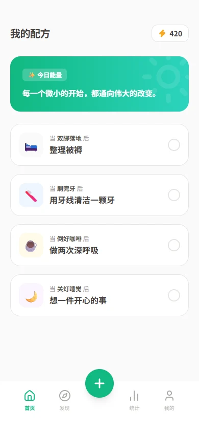
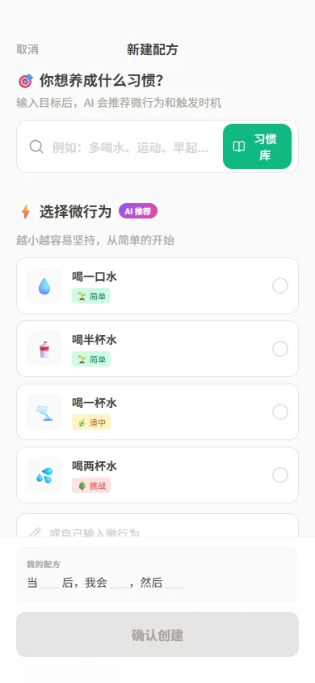
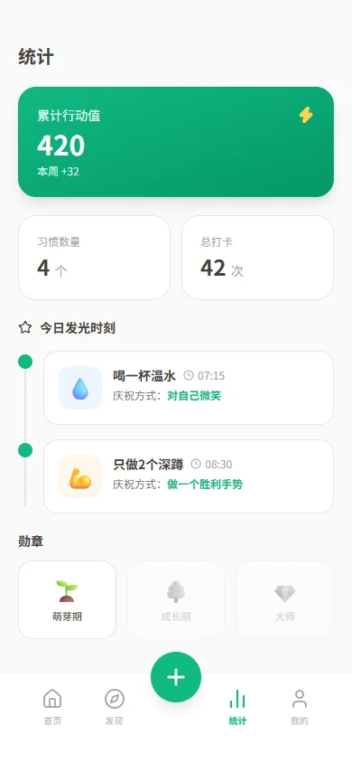
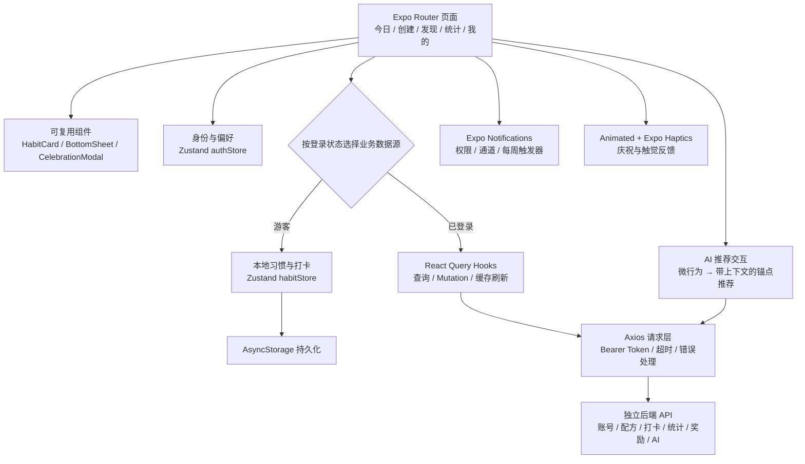
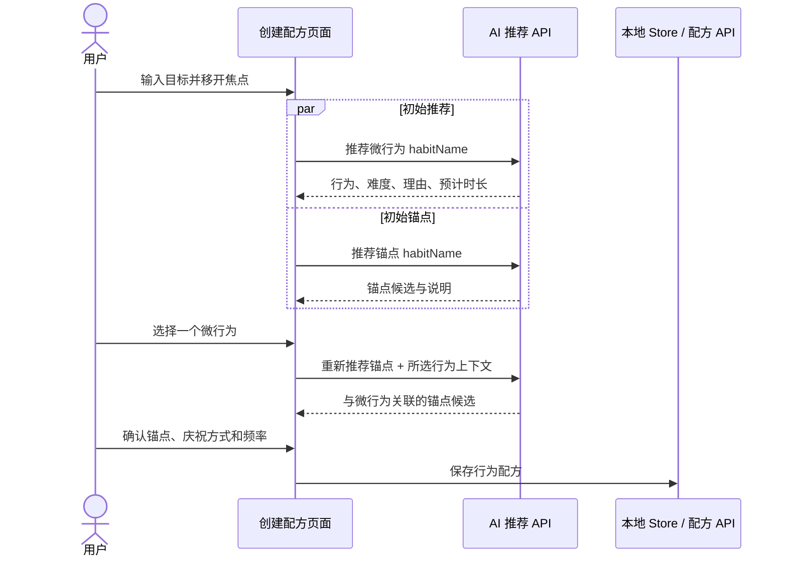

# Tiny Habits · 微习惯

**把“我想养成一个习惯”，变成今天就能开始的一小步。**

Tiny Habits 是一款基于福格行为模型的习惯养成应用，使用 **Expo 54 + React Native 0.81 + TypeScript** 构建。它将 AI 微行为推荐、生活锚点、打卡反馈和行动值奖励串成一条产品流程，帮助用户把抽象目标写成可执行的行为配方：

> 当 **倒好咖啡** 后，我会 **做两次深呼吸**，然后 **对自己说“太棒了”**。

本仓库包含移动端源码、后端接口调用层、产品与架构文档、数据库设计和交互原型。账号、云端数据与 AI 推荐通过独立后端接入。

[功能介绍](#功能介绍) · [系统架构](#系统架构) · [实现细节](#实现细节) · [本地运行](#本地运行) · [源码与文档](#源码与文档)

## 界面预览

以下是仓库中 HTML 设计原型的预览，展示产品布局与交互方向；图中数据为示例，实际应用界面以当前代码为准。

<table>
  <tr>
    <th>今日配方</th>
    <th>创建微行为</th>
    <th>行动反馈</th>
  </tr>
  <tr>
    <td></td>
    <td></td>
    <td></td>
  </tr>
</table>

原型源码：[首页](design/home.html) · [创建配方](design/create.html) · [统计](design/achievement.html) · [奖励中心](design/rewards.html)

## 工程亮点

- **让 AI 推荐进入业务流程**：目标输入后请求微行为与锚点建议；选中微行为后，进一步把行为内容和难度作为上下文传给锚点接口，形成有关联的推荐。
- **本地与云端两种数据路径**：游客的配方和打卡记录使用 Zustand + AsyncStorage；登录后通过 React Query 和后端 API 读写用户数据，降低首次体验门槛。
- **区分客户端状态与服务端状态**：Zustand 管理身份、偏好和本地数据；React Query 管理远程查询、缓存、Mutation 及数据失效刷新。
- **处理跨页面的数据联动**：打卡、取消打卡、创建配方和兑换奖励后，刷新相关列表与统计查询，让操作结果回到首页、统计页和奖励中心。
- **细化移动端交互**：原生驱动的庆祝动画、触觉反馈、相机与相册权限、五套主题色和中英双语，让数据操作有可感知的反馈。
- **将时间规则落实到调度层**：统一 JavaScript、业务接口和 Expo 通知的星期表示，按配方频率构造每周循环提醒。

## 功能介绍

| 模块 | 用户能做什么 | 对应实现 |
| --- | --- | --- |
| 今日配方 | 查看按星期筛选的微行为，打卡或确认取消打卡 | `app/(tabs)/index.tsx` |
| 创建与编辑 | 设置目标、锚点、微行为、庆祝方式、执行频率和提醒时间 | `app/create.tsx` |
| AI 微行为推荐 | 查看包含难度、预计时长与设计理由的建议，选择后填入配方 | `services/api/ai.ts` |
| AI 锚点推荐 | 根据目标和选中的微行为，寻找适合触发行动的生活场景 | `useAiRecommend.ts`、`app/create.tsx` |
| 习惯与配方库 | 浏览分类、搜索习惯、使用模板；创建页提供本地预置习惯 | 创建页与发现页 |
| 行动统计 | 查看行动值、微行为数量、打卡次数和今日“发光时刻” | `app/(tabs)/stats.tsx` |
| 奖励中心 | 创建自定义奖励，通过后端接口使用可用行动值兑换 | `app/rewards.tsx` |
| 账号与资料 | 注册、登录、重置密码、编辑资料、拍摄或选择头像 | `app/auth/`、`app/profile/` |
| 个性化 | 切换深色模式、中英语言和五种主题配色 | `authStore.ts`、`utils/i18n.ts` |
| 本地提醒模块 | 根据星期与时间构造循环通知，处理权限和 Android 通知通道 | `services/notifications.ts` |

## 从行为模型到产品设计

福格行为模型关注动机、能力和提示同时出现的条件。项目用“锚点 + 微行为 + 庆祝”组织配方，将行为设计转化为页面和数据模型。

| 设计要素 | 在产品中的表达 | 实现方式 |
| --- | --- | --- |
| 降低行动门槛 | 从能立刻开始的小动作出发 | 微行为字段、难度标签、AI 候选卡片 |
| 提供行动提示 | 将新行为绑定到已有的生活动作 | 锚点推荐、配方句式、每周提醒调度 |
| 提供即时反馈 | 完成后立刻看到正向反馈 | 庆祝弹窗、触觉反馈、行动值与奖励 |

核心实体 [`MicroBehavior`](types/habit.ts) 同时保存 `anchor`、`behavior`、`celebration`、`frequency`、`reminderEnabled` 和 `reminderTime`。同一份行为配方贯穿创建、今日列表、打卡和提醒调度。

## 系统架构



页面通过业务 Hooks 和 Store 读取数据，API 模块负责请求与响应转换。根布局 [`app/_layout.tsx`](app/_layout.tsx) 注册 `QueryClientProvider`、文件路由、主题同步和通知处理器。

后端设计约定采用 Spring Boot 与 MySQL，相关说明见[架构文档](docs/architecture.md)和[数据库设计](docs/database.md)。服务端源码与部署需要单独准备。

## 实现细节

### 1. 双模式数据源：先体验，再登录

游客可以从本地预置习惯开始，创建配方并记录打卡。登录后，首页等业务页面切换到该用户的云端查询。以首页为例：

```ts
const { data: cloudBehaviors = [] } = useUserMicroBehaviors(user?.id);
const localBehaviors = useHabitStore((s) => s.microBehaviors);
const microBehaviors = user?.id ? cloudBehaviors : localBehaviors;
```

| 数据 | 游客路径 | 登录路径 |
| --- | --- | --- |
| 配方与微行为 | Zustand + AsyncStorage | 用户微行为 API |
| 创建页习惯库 | 用户本地习惯 + 预置习惯 | 云端习惯库 API |
| 打卡记录 | 本地 Store 写入和持久化 | 打卡、取消打卡和今日记录 API |
| 统计 | 从本地记录计算 | 后端统计 API |

本地基础操作可离线进行；AI 推荐依赖后端网络。自动将游客数据迁移到账户仍是待实现能力，当前登录 Hooks 保留了相应 TODO。

### 2. AI 推荐：目标拆解与上下文联动

AI 接入分为两个任务：**推荐做什么**，以及**推荐在什么情境下做**。



实现位于 [`app/create.tsx`](app/create.tsx) 和 [`services/api/ai.ts`](services/api/ai.ts)：

- 目标不少于两个字符时，失焦触发微行为与锚点两类初始请求。
- 用户选择微行为后，将其名称、内容和难度写入 `userContext`，再次请求锚点推荐。
- 返回结果映射为可选择卡片，并填入配方字段；请求期间展示加载状态、禁用对应推荐按钮。
- AI 请求使用独立的 **60 秒超时**；后端响应的 `data` 为 JSON 字符串，由 API 层解析为类型化的推荐列表。

接口文档描述的模型为 **GLM-4-Flash**，并收录了基于福格行为模型的提示词约束：具体可执行、不同难度、说明设计理由，以及结构化 JSON 输出。本仓库实现客户端的请求、解析与交互；模型调用由独立后端提供。

| AI 接口 | 输入重点 | 返回内容 |
| --- | --- | --- |
| `POST /api/ai/recommend/micro-behaviors` | 目标、可选分类与用户上下文 | 微行为、难度、图标、说明、预计时长 |
| `POST /api/ai/recommend/anchors` | 目标、可选时段与所选微行为上下文 | 锚点、说明、时段和图标 |

详细协议和提示词见 [AI 推荐 API 文档](docs/ai-recommendation-api.md)。

### 3. 服务端状态与页面更新

[`services/api/queryClient.ts`](services/api/queryClient.ts) 集中定义缓存策略和 Query Keys，业务 Hooks 按用户与资源组织查询。默认查询新鲜期为 **5 分钟**、缓存清理时间为 **10 分钟**，并配置失败重试和网络重连刷新。

打卡成功后，`useCheckIn` 更新用户行动值，并使打卡历史、今日打卡、微行为列表和用户统计四类查询失效；页面随后获取新结果。取消打卡、编辑配方和兑换奖励也有对应的数据刷新路径。

[`services/api/client.ts`](services/api/client.ts) 统一处理 Bearer Token、10 秒普通请求超时、业务错误和网络异常；HTTP 401 时清除本地身份状态。该分层让页面围绕“用户做什么”组织交互，公共请求逻辑集中维护。

### 4. 每周提醒：连接业务频率与原生通知

配方频率以 **1–7 表示周一到周日**。JavaScript 和 Expo 通知使用不同的星期编号，调度前需要转换：

| 星期 | JavaScript `getDay()` | 业务频率 | Expo 通知 |
| --- | ---: | ---: | ---: |
| 周一 | 1 | 1 | 2 |
| 周日 | 0 | 7 | 1 |

[`utils/dateHelper.ts`](utils/dateHelper.ts) 处理今日频率匹配；[`services/notifications.ts`](services/notifications.ts) 创建 Android 通知通道、请求权限、取消旧计划，并按“微行为 × 选中的星期”生成循环触发器。通知文案组合锚点和微行为，让提示保留具体行动场景。

调度服务已有实现，提醒开关的状态接线和原生平台触发仍需继续完善、真机验证。

### 5. 把反馈做到交互里

[`CelebrationModal`](components/habit/CelebrationModal.tsx) 使用 `Animated.parallel`、`Animated.sequence` 和弹簧动画组合卡片缩放、图标缩放与旋转，并开启原生驱动。首页在打卡成功后展示用户选择的庆祝文案，同时触发 `expo-haptics` 反馈。

主题与语言偏好使用 AsyncStorage 持久化；`useTheme`、NativeWind 深色样式和中英词典共同支持全局界面切换。个人资料页通过 Image Picker 接入相机、相册及头像上传接口。

## 技术栈

以下版本依据当前 `package.json`，部分早期设计文档中的版本为初始方案。

| 层次 | 技术 |
| --- | --- |
| 应用框架 | Expo SDK 54、React Native 0.81.5、React 19.1 |
| 语言与路由 | TypeScript 5.9、Expo Router 6 |
| 客户端状态 | Zustand 5、AsyncStorage 2 |
| 服务端状态与请求 | TanStack React Query 5、Axios |
| 样式 | NativeWind 4、Tailwind CSS 3、Linear Gradient |
| 动画与设备能力 | React Native Animated、Expo Haptics、Image Picker、Notifications |
| 接口约定 | Spring Boot / MySQL 后端、GLM-4-Flash 推荐服务，详见设计文档 |

## 本地运行

准备 Node.js **20.19.4 或更高版本**、npm，以及 Expo Go 或相应原生开发环境。

```bash
git clone https://github.com/wywzixin/tiny-habit.git
cd tiny-habit
npm ci
npm start
```

使用 Expo 提供的二维码或开发入口打开应用。可从游客模式查看本地配方和基础打卡流程。

| 命令 | 用途 |
| --- | --- |
| `npm start` | 启动 Expo 开发服务 |
| `npm run android` | 启动 Android 调试入口，需要设备或模拟器 |
| `npm run ios` | 启动 iOS 调试入口，模拟器需 macOS / Xcode |
| `npm run web` | Web 调试入口；按 Expo 提示补齐 Web 依赖，原生能力需单独适配 |

云端与 AI 功能需要配置后端地址。修改 [`services/api/client.ts`](services/api/client.ts) 中的 `API_BASE_URL`，指向实际后端服务：

```ts
export const API_BASE_URL = 'http://<你的电脑局域网IP>:8081';
```

手机真机访问电脑上的服务时，需要使用手机可访问的局域网地址。后端实现需满足[接口文档](docs/api.md)与 [AI 推荐接口](docs/ai-recommendation-api.md)约定。

## 源码与文档

| 入口 | 内容 |
| --- | --- |
| [`app/(tabs)/`](app/%28tabs%29/) | 首页、发现、统计、我的四个主要页面 |
| [`app/create.tsx`](app/create.tsx) | 配方创建与编辑、习惯库、AI 推荐联动 |
| [`app/rewards.tsx`](app/rewards.tsx) | 奖励创建与兑换交互 |
| [`components/habit/`](components/habit/) | 习惯卡片、庆祝弹窗、取消确认 |
| [`stores/`](stores/) | 身份、偏好、本地习惯和奖励状态 |
| [`services/api/hooks/`](services/api/hooks/) | 业务查询、Mutation 和缓存刷新 |
| [`services/notifications.ts`](services/notifications.ts) | 本地提醒调度 |
| [`types/habit.ts`](types/habit.ts) | 习惯、微行为、打卡、奖励等领域类型 |
| [`utils/i18n.ts`](utils/i18n.ts)、[`hooks/useTheme.ts`](hooks/useTheme.ts) | 中英词典与主题配置 |
| [产品需求](docs/prd.md) · [架构设计](docs/architecture.md) | 产品目标、模块划分和系统设计 |
| [双模式设计](docs/DUAL_MODE_DESIGN.md) · [数据库设计](docs/database.md) | 本地/云端数据路径与后端表结构 |
| [AI 推荐协议与提示词](docs/ai-recommendation-api.md) | 微行为与锚点推荐的输入输出约定 |
| [`design/`](design/) | 九份 HTML 交互原型 |

## 后续完善

- 游客数据迁移到账户，包括迁移失败重试、去重及切换后的数据一致性。
- 提醒开关状态、跨日打卡状态和不同原生平台的真机验证。
- 推荐结果的运行时校验、异常场景反馈，以及核心流程自动化测试。
